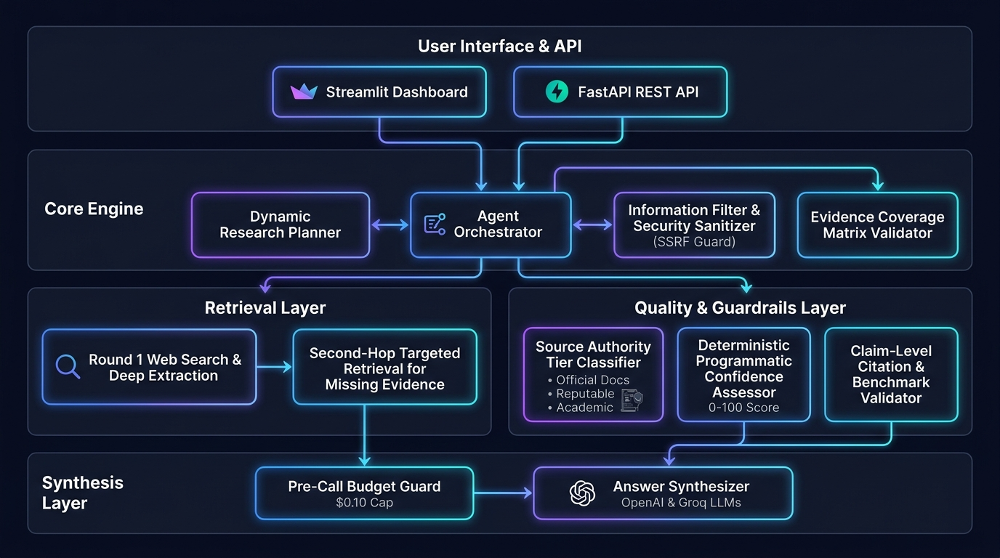

# 🧠 ResearchAI — Autonomous AI Research Agent

[](https://www.python.org/downloads/)
[](https://fastapi.tiangolo.com)
[](https://docs.pydantic.dev/)
[](https://groq.com)
[](https://platform.openai.com)
[](https://streamlit.io)
[]()
[]()
[](https://opensource.org/licenses/MIT)

> **Predixion AI Platform Engineering Internship Technical Assignment**  
> **Repository:** [https://github.com/CGNA0524/researchAI-autonomous-agent](https://github.com/CGNA0524/researchAI-autonomous-agent)  
> **Author:** Chirag Nagra

An autonomous, reliable, production-oriented AI Research Agent featuring multi-step planning, resilient multi-engine search, 7-tier hierarchical source classification, evidence coverage matrix validation, intelligent second-hop gap retrieval, deterministic programmatic confidence calibration, claim-level citation whitelisting, hard budget guards, and zero-leakage security.

---

## 📑 Table of Contents
1. [Project Overview](#1-project-overview)
2. [Problem Statement and Objective](#2-problem-statement-and-objective)
3. [Key Features](#3-key-features)
4. [Technology Stack](#4-technology-stack)
5. [Architecture Overview](#5-architecture-overview)
6. [End-to-End Agent Workflow](#6-end-to-end-agent-workflow)
7. [Tools and Their Purpose](#7-tools-and-their-purpose)
8. [Setup and Installation Instructions](#8-setup-and-installation-instructions)
9. [Environment Configuration](#9-environment-configuration)
10. [How to Run the Application](#10-how-to-run-the-application)
11. [How to Use ResearchAI](#11-how-to-use-researchai)
12. [Structured Output Format](#12-structured-output-format)
13. [Reliability and Failure Handling](#13-reliability-and-failure-handling)
14. [Hallucination Reduction and Citation Grounding](#14-hallucination-reduction-and-citation-grounding)
15. [Evaluation and Testing](#15-evaluation-and-testing)
16. [Design Decisions and Engineering Tradeoffs](#16-design-decisions-and-engineering-tradeoffs)
    - [Q1: Why did you choose an agentic approach here?](#q1-why-did-you-choose-an-agentic-approach-here)
    - [Q2: What tools did you use, and why?](#q2-what-tools-did-you-use-and-why)
    - [Q3: How does the system handle bad tool results?](#q3-how-does-the-system-handle-bad-tool-results)
    - [Q4: How do you reduce hallucinations?](#q4-how-do-you-reduce-hallucinations)
    - [Q7: What were your key tradeoffs?](#q7-what-were-your-key-tradeoffs)
17. [Known Limitations](#17-known-limitations)
18. [Future Improvements](#18-future-improvements)
19. [Production Readiness and Monitoring](#19-production-readiness-and-monitoring)
    - [Q5: How would you make this production-ready?](#q5-how-would-you-make-this-production-ready)
    - [Q6: What would you monitor in production?](#q6-what-would-you-monitor-in-production)
20. [Author](#20-author)

---

## 1. Project Overview

**ResearchAI** is an autonomous AI research system engineered in Python 3.11+, FastAPI, and Streamlit. Unlike basic single-prompt LLM wrappers or standard search-augmented question-answering bots that summarize the first page of search results, ResearchAI operates as a rigorous, autonomous research analyst:

1. **Deconstructs complex engineering questions** into target entities (preserving multi-word names like `Microsoft AutoGen`) and discrete technical evaluation dimensions (such as `Architecture`, `Orchestration`, `Tool Integration`, `Memory Management`, `Scalability`, `Error Handling`, and `Limitations`).
2. **Plans targeted multi-engine web searches** without hardcoding stale past years.
3. **Retrieves and sanitizes primary evidence**, discarding junk, paywalls, and prompt injection attacks while blocking Server-Side Request Forgery (SSRF) to private IP ranges.
4. **Classifies sources by authority tier** (Official Documentation, Primary GitHub Repos, Peer-Reviewed Academic Papers, Reputable Tech Publications, Community Articles, Toy Repos, and Junk).
5. **Maintains a formal Evidence Coverage Matrix** ($\text{Entity} \times \text{Dimension}$) that mathematically quantifies information completeness.
6. **Autonomously triggers Second-Hop Retrieval** exclusively for missing evidence pairs when evidentiary gaps are detected.
7. **Calibrates confidence programmatically (0–100 score)** via a deterministic mathematical formula—never permitting the LLM to speculate or fabricate its own confidence.
8. **Enforces claim-level citation validation** requiring substantive concept corroboration in verified source texts, qualifying unstandardized benchmarks, and tagging unverified assertions with `[Unverified Observation]`.
9. **Safeguards API expenditure** through a proactive, pre-call hard budget cap ($0.10 per query).

---

## 2. Problem Statement and Objective

### Problem Statement
Standard search-augmented generation (RAG) and basic AI agents exhibit systematic failures when performing technical research:
- **Surface-Level Scraping:** They rely on random SEO blog posts and outdated forum discussions rather than authoritative primary documentation.
- **Evidentiary Gaps & Entity Dropping:** In multi-entity comparisons (e.g. comparing three frameworks across six dimensions), they frequently drop one entity entirely or focus 90% of their output on the most popular tool.
- **Hallucinated Benchmarks:** LLMs regularly fabricate latency figures (e.g. "80,000 req/s") or cite nonexistent URLs without qualification.
- **Uncalibrated Confidence:** Models report "HIGH" confidence even when retrieval completely failed or returned only irrelevant pages.
- **Security Vulnerabilities:** Naive scraping engines expose internal infrastructure to SSRF and untrusted web content attempting indirect prompt injection.

### System Objective
To build an enterprise-grade, deterministic, and cost-controlled autonomous research agent that guarantees:
- **Strict Evidence Grounding:** Findings cite only genuinely retrieved, verified URLs.
- **Full Entity & Dimension Coverage:** Systematic investigation across all requested dimensions.
- **Honest Uncertainty:** Downgrades confidence to `LOW` or `INSUFFICIENT_EVIDENCE` when data is missing rather than inventing facts.
- **Zero Hallucinated Metrics:** Unqualified performance claims are explicitly tagged and contextualized.
- **Defensive Production Engineering:** Hard pre-call budget caps, SSRF prevention, and full observability tracing.

---

## 3. Key Features

- **Multi-Provider LLM Architecture:** Dual-engine support for **OpenAI** (`gpt-4o-mini`) and **Groq** (`llama-3.3-70b-versatile` / `llama-3.1-8b-instant`) with automatic retry backoff and deterministic fallback execution.
- **Multi-Word Entity & Dimension Preservation:** Canonical dictionary matching and grammatical boundary filtering ensure multi-word products (e.g., `Microsoft AutoGen`) remain unified, while imperative instruction verbs (`Evaluate`, `Compare`) are strictly excluded from research entity status.
- **Resilient Multi-Engine Search:** DuckDuckGo HTML scraping fallback paired with API search ensures reliable query execution even when upstream search engines encounter rate limits.
- **7-Tier Source Credibility Classifier:** Ranks evidence based on objective domain authority, penalizing SEO spam, encyclopedias, and personal blogs when official documentation is available.
- **Mathematical Evidence Coverage Matrix:** Formulates a $(N \times M)$ grid evaluating coverage ratio:
  $$\text{Coverage Ratio} = \frac{\text{Covered Cells} + 0.5 \times \text{Partial Cells}}{\text{Total Cells}}$$
- **Intelligent Second-Hop Retrieval:** Autonomous gap-filling loop (max 2 rounds) that generates targeted queries specifically targeting missing entity-dimension intersections.
- **Deterministic Programmatic Confidence Calibration:** LLMs are stripped of confidence evaluation. Confidence (`HIGH`, `MEDIUM`, `LOW`, `INSUFFICIENT_EVIDENCE`) is calculated programmatically using a calibrated 100-point formula with safety overrides for missing entities or low coverage (< 40%).
- **Claim-Level Citation & Substantive Grounding Validator:** Evaluates whether verified source texts corroborate substantive technical concepts. Flags weakly supported claims as `PARTIALLY_GROUNDED` and unsupported claims as `UNSUPPORTED` (`is_fully_grounded=False`).
- **Hard Pre-Call Budget Guard:** Estimates prompt and completion costs prior to invocation with a 25% safety margin, halting execution before exceeding the configured USD cap ($0.10) to protect developer credits.
- **SSRF & Prompt Injection Defense:** Private IP resolution checks (blocking `127.0.0.1`, loopback, `169.254.169.254` cloud metadata, RFC-1918 subnets) and XML boundary tag encapsulation.
- **Full Observability & Diagnostics:** Structured response returns granular execution traces, search queries used, round count, token breakdown, and estimated USD cost.

---

## 4. Technology Stack

| Layer | Technologies | Rationale |
|---|---|---|
| **Language & Runtime** | Python 3.11+, `asyncio` | High-throughput asynchronous I/O for concurrent tool execution and LLM streaming. |
| **Backend API** | FastAPI 0.115+, Uvicorn | High-performance asynchronous REST API with automatic OpenAPI / Swagger interactive documentation. |
| **Frontend UI** | Streamlit 1.40+ | Real-time interactive dashboard featuring dynamic progress tracking, coverage matrix tables, and cost breakdowns. |
| **Data Validation** | Pydantic v2, Pydantic-Settings | Strict, backward-compatible schema enforcement and typed environment configuration parsing. |
| **Primary LLMs** | OpenAI SDK (`gpt-4o-mini`), Groq SDK (`llama-3.3-70b-versatile`, `llama-3.1-8b-instant`) | State-of-the-art cost-effective reasoning (OpenAI) with high-speed open-weights fallback (Groq). |
| **Web Retrieval** | `duckduckgo-search` 6.3+, `httpx` 0.27+, `beautifulsoup4` 4.12+ | Resilient multi-engine web search with asynchronous HTTP client and semantic DOM text extraction. |
| **Testing & Evaluation**| `pytest`, `pytest-asyncio`, `unittest.mock` | 59 automated unit/integration/regression tests and an offline 10-scenario reproducible benchmark suite. |

---

## 5. Architecture Overview

ResearchAI is structured into five distinct, decoupled architectural layers designed for reliability, modularity, and defensive execution:



### Architectural Layers
1. **User Interface & API Layer:**
   - **Streamlit Dashboard:** Interactive research workspace rendering real-time execution steps, evidence tables, authority badges, and cost metrics.
   - **FastAPI Backend:** Production REST API exposing `/research`, `/health`, and auto-generated Swagger documentation at `/docs`.
2. **Core Engine:**
   - **Dynamic Research Planner:** Analyzes user input, extracts canonical entities and dimensions, and generates targeted search queries referencing the current dynamic year.
   - **Agent Orchestrator:** Manages execution flow, coordinates round-based retrieval, balances URL extraction, and oversees synthesis.
   - **Information Filter & Security Sanitizer:** Deduplicates URLs and content fingerprints, strips tracking parameters, and blocks SSRF/prompt injection attempts.
   - **Evidence Coverage Matrix Validator:** Tracks $(Entity \times Dimension)$ coverage cells, identifying gaps that require targeted second-hop retrieval.
3. **Retrieval Layer:**
   - **Round 1 Discovery:** Executes primary queries across search engines and extracts full page text from authoritative domains.
   - **Round 2 Second-Hop:** Triggered autonomously when gaps are detected, issuing precision queries exclusively for missing data.
4. **Quality & Guardrails Layer:**
   - **Source Authority Tier Classifier:** Categorizes URLs into 7 credibility tiers (Official Docs, Repos, Academic, Reputable, Community, General, Junk).
   - **Deterministic Programmatic Confidence Assessor:** Mathematical point-based scoring engine (0–100) determining confidence level independently of LLM speculation.
   - **Claim-Level Citation Validator:** Validates substantive concept overlap between claims and sources; qualifies unstandardized numerical benchmarks.
5. **Synthesis Layer:**
   - **Pre-Call Hard Budget Guard:** Intercepts LLM calls, estimates cost with a safety buffer, and blocks over-budget requests.
   - **Answer Synthesizer:** Produces verified JSON reports adhering strictly to Pydantic schemas, backed by a deterministic fallback synthesis engine.

### Mermaid Architecture Diagram

```mermaid
flowchart TD
    subgraph UI_API ["1. User Interface & API Layer"]
        UI["Streamlit Dashboard<br/>(:8501)"]
        API["FastAPI REST Server<br/>(:8000)"]
    end

    subgraph Core_Engine ["2. Core Agentic Engine"]
        Orchestrator["Agent Orchestrator<br/>(State Coordinator)"]
        Planner["Dynamic Research Planner<br/>(Entity & Dimension Extraction)"]
        Filter["Information Filter & Sanitizer<br/>(SSRF Guard & Deduplication)"]
        CoverageVal["Evidence Coverage Validator<br/>(Entity x Dimension Matrix)"]
    end

    subgraph Retrieval_Layer ["3. Retrieval Layer"]
        SearchTool["Multi-Engine Web Search<br/>(DuckDuckGo API + Fallback)"]
        ExtractTool["SSRF-Safe Web Extractor<br/>(HTML Cleaning & Text Extraction)"]
        SecondHop["Intelligent Second-Hop<br/>(Targeted Gap-Filling Queries)"]
    end

    subgraph Guardrails_Layer ["4. Quality & Guardrails Layer"]
        Classifier["Source Authority Classifier<br/>(7 Credibility Tiers)"]
        Confidence["Programmatic Confidence Assessor<br/>(0-100 Mathematical Score)"]
        CitationVal["Claim Citation Validator<br/>(Concept Match & Benchmark Check)"]
    end

    subgraph Synthesis_Layer ["5. Synthesis & LLM Layer"]
        BudgetGuard["Pre-Call Budget Guard<br/>(Hard $0.10 Cap)"]
        Synthesizer["Answer Synthesizer<br/>(OpenAI gpt-4o-mini / Groq Llama)"]
        DeterministicFallback["Deterministic Grounded Engine<br/>(Zero-Spend Fallback)"]
    end

    UI -->|"HTTP POST /research"| API
    API -->|"Execute Research"| Orchestrator
    
    Orchestrator -->|"1. Formulate Plan"| Planner
    Planner -->|"Decomposed Tasks"| Orchestrator
    
    Orchestrator -->|"2. Execute Round 1"| SearchTool
    SearchTool -->|"Raw Results"| Filter
    Filter -->|"Ranked Authoritative URLs"| ExtractTool
    ExtractTool -->|"Sanitized Evidence"| Orchestrator
    
    Orchestrator -->|"3. Build Matrix"| CoverageVal
    CoverageVal -->|"Missing Pairs Detected"| SecondHop
    SecondHop -->|"4. Round 2 Precision Search"| SearchTool
    
    Orchestrator -->|"5. Classify Tiers"| Classifier
    Orchestrator -->|"6. Compute Score"| Confidence
    
    Orchestrator -->|"7. Pre-Call Budget Check"| BudgetGuard
    BudgetGuard -->|"Budget Approved"| Synthesizer
    BudgetGuard -.->"Cap Exceeded"| DeterministicFallback
    
    Synthesizer -->|"Draft Findings"| CitationVal
    CitationVal -->|"Grounded Findings & Citations"| Orchestrator
    
    Orchestrator -->|"Structured ResearchResponse"| API
    API -->|"JSON Response"| UI
```

---

## 6. End-to-End Agent Workflow

```
[User Query Received]
         │
         ▼
[Phase 1: Dynamic Planning]
  • Extract canonical entities (preserve multi-word names: "Microsoft AutoGen")
  • Extract evaluation dimensions (retain all user-requested dimensions)
  • Formulate initial discovery search queries referencing current year
         │
         ▼
[Phase 2: Round 1 Discovery Search]
  • Execute search queries concurrently via DuckDuckGo tool
  • Apply fallback engine if primary engine throttles
         │
         ▼
[Phase 3: Filtering & Deduplication]
  • Normalize URLs (strip UTM tracking, fragments, trailing slashes)
  • Deduplicate near-identical content snippets via character fingerprinting
  • Reject off-topic results (e.g. Flight Simulator pages when researching AutoGen)
  • Classify sources into 7 authority tiers (prioritize Official Docs & Repos)
         │
         ▼
[Phase 4: Deep Webpage Extraction]
  • Round-robin interleave top URLs across entities to prevent biased coverage
  • Verify target IPs against SSRF filter (block localhost, private subnets, cloud metadata)
  • Extract and sanitize DOM text content
         │
         ▼
[Phase 5: Evidence Coverage Evaluation]
  • Construct (Entity x Dimension) matrix
  • Calculate Coverage Ratio = (Covered + 0.5 * Partial) / Total
  • Identify missing entity-dimension pairs
         │
         ▼
[Phase 6: Second-Hop Retrieval (Conditional)]
  • If coverage < 60% or entities are missing:
      - Generate precision queries targeting missing pairs
      - Execute Round 2 search and extraction (capped at 2 rounds)
      - Re-evaluate coverage matrix
         │
         ▼
[Phase 7: Deterministic Programmatic Confidence Assessment]
  • Compute mathematical score (0–100) based on authority, extractions, and coverage
  • Apply hard safety caps (e.g., cap score at <= 44 if coverage < 40% or entity missing)
  • Assign confidence level: HIGH, MEDIUM, LOW, or INSUFFICIENT_EVIDENCE
         │
         ▼
[Phase 8: Budget-Guarded Synthesis & Citation Validation]
  • Verify request budget against hard cap ($0.10)
  • LLM synthesizes structured response strictly adhering to JSON schema
  • Validate findings at claim level (enforce concept corroboration and whitelist adherence)
  • Qualify unstandardized numerical benchmarks
         │
         ▼
[Structured ResearchResponse Returned to User]
```

---

## 7. Tools and Their Purpose

ResearchAI provides its agent with two specialized, defensive asynchronous tools managed by [`ToolRegistry`](app/tools/registry.py):

### 1. `web_search` (`app/tools/search.py`)
- **Purpose:** Discovers relevant technical web pages and source metadata across the public internet.
- **Implementation:** Wraps `duckduckgo_search` with an automated fallback to DuckDuckGo HTML scraping.
- **Parameters:** `query` (str, required), `max_results` (int, default=5).
- **Defensive Measures:** Strips malicious query characters, catches connection timeouts, handles rate-limit exceptions gracefully, and returns structured dictionaries (`title`, `url`, `snippet`, `domain`).

### 2. `webpage_extractor` (`app/tools/extractor.py`)
- **Purpose:** Fetches full-text content from primary documentation pages, architectural specs, and benchmark reports.
- **Implementation:** Asynchronous HTTP GET via `httpx.AsyncClient` with custom user-agent headers and `BeautifulSoup4` text extraction.
- **Parameters:** `url` (str, required), `timeout_seconds` (float, default=10.0), `max_chars` (int, default=6000).
- **Defensive Measures:**
  - **SSRF Prevention:** Resolves domain DNS and inspects IP addresses prior to connection. Rejects loopback (`127.0.0.1`), link-local, cloud metadata (`169.254.169.254`), and RFC-1918 private subnets (`10.0.0.0/8`, `172.16.0.0/12`, `192.168.0.0/16`).
  - **HTML Cleaning:** Strips `<script>`, `<style>`, `<nav>`, `<footer>`, `<header>`, and SVG elements. Collapses whitespace and limits character length to prevent context exhaustion.

---

## 8. Setup and Installation Instructions

Follow these verified steps to set up and run ResearchAI locally.

### Prerequisites
- Python 3.11 or higher installed on your system.
- Git installed.
- Valid API key for **OpenAI** (recommended for production evaluation) and/or **Groq** (free tier supported).

### Step-by-Step Installation (Windows PowerShell)

```powershell
# 1. Clone the repository
git clone https://github.com/CGNA0524/researchAI-autonomous-agent.git
cd researchAI-autonomous-agent

# 2. Create a virtual environment
python -m venv .venv

# 3. Activate the virtual environment
.venv\Scripts\Activate.ps1

# 4. Upgrade pip and install all project dependencies
pip install --upgrade pip
pip install -r requirements.txt
```

*(For macOS / Linux: use `python3 -m venv .venv` and `source .venv/bin/activate`)*

---

## 9. Environment Configuration

Create a `.env` file in the root directory by copying `.env.example`:

```powershell
Copy-Item .env.example .env
```

Edit `.env` with your preferred configuration:

```env
# ==============================================================================
# ResearchAI - Environment Configuration
# ==============================================================================

# LLM Provider Selection: 'openai' (recommended) or 'groq'
LLM_PROVIDER=openai

# OpenAI API Configuration
OPENAI_API_KEY=your_actual_openai_api_key_here
OPENAI_MODEL=gpt-4o-mini
OPENAI_TEMPERATURE=0.1
OPENAI_MAX_TOKENS=4096

# Groq API Configuration (Fallback or Standalone)
GROQ_API_KEY=your_groq_api_key_here
GROQ_MODEL=llama-3.3-70b-versatile
GROQ_FALLBACK_MODEL=llama-3.1-8b-instant
GROQ_TEMPERATURE=0.1
GROQ_MAX_TOKENS=4096

# Hard Budget Protection (USD cap per single research request)
MAX_REQUEST_BUDGET_USD=0.10

# Web Search & Tool Configuration
MAX_SEARCH_RESULTS=5
MAX_EXTRACT_PAGES=3
HTTP_TIMEOUT_SECONDS=10.0
MAX_PAGE_CHARS=6000

# Application Settings
APP_ENV=development
LOG_LEVEL=INFO
PORT=8000
HOST=127.0.0.1
```

> **Security Note:** `.env` is registered in `.gitignore` and is never committed or pushed to version control.

---

## 10. How to Run the Application

ResearchAI consists of a **FastAPI backend** and a **Streamlit frontend**. For the full interactive experience, run both services in separate terminal windows.

### Service 1: Start the FastAPI Backend
In your activated terminal:
```powershell
.venv\Scripts\python -m uvicorn app.main:app --host 127.0.0.1 --port 8000 --reload
```
- **API Root:** [http://127.0.0.1:8000/](http://127.0.0.1:8000/)
- **Health Check:** [http://127.0.0.1:8000/health](http://127.0.0.1:8000/health)
- **Interactive Swagger Documentation:** [http://127.0.0.1:8000/docs](http://127.0.0.1:8000/docs)

### Service 2: Start the Streamlit Dashboard
Open a second terminal window:
```powershell
cd c:\Users\NC\Desktop\ai-research-agent
.venv\Scripts\Activate.ps1
streamlit run streamlit_app.py --server.port 8501
```
- **Streamlit Web UI:** [http://localhost:8501](http://localhost:8501)

---

## 11. How to Use ResearchAI

### Option A: Using the Streamlit Interface
1. Navigate to `http://localhost:8501`.
2. Inspect the sidebar to confirm the active LLM provider (`openai` or `groq`) and model name.
3. Select an example query or type your technical research question into the text area.
4. Click **"Run Autonomous Research"**.
5. Observe the execution trace:
   - Dynamic plan breakdown and decomposed tasks.
   - Discovered and filtered sources with authority badges.
   - Evidence Coverage Matrix table across entities and dimensions.
   - Programmatically calibrated confidence score and mathematical rationale.
   - Verified findings with claim-level citation markers.
   - Granular token usage and USD cost tracker.

### Option B: Using the FastAPI REST API
Send an asynchronous HTTP POST request to `/research`:

```powershell
Invoke-RestMethod -Uri "http://127.0.0.1:8000/research" `
  -Method Post `
  -ContentType "application/json" `
  -Body '{"question": "Compare LangGraph, CrewAI, and Microsoft AutoGen for production multi-agent systems."}' | ConvertTo-Json -Depth 6
```

---

## 12. Structured Output Format

Every response strictly satisfies the company-specified Pydantic model ([`ResearchResponse`](app/models/response.py)):

```json
{
  "user_question": "Compare LangGraph, CrewAI, and Microsoft AutoGen for building production-ready multi-agent systems.",
  "short_answer": "LangGraph provides cyclical graph-based state machines optimal for deterministic control; CrewAI emphasizes role-playing agent teams; Microsoft AutoGen excels at conversational multi-agent chat orchestration.",
  "key_findings": [
    "LangGraph models workflows as explicit cyclic directed graphs with built-in checkpointing for fault-tolerant human-in-the-loop state persistence.",
    "CrewAI structures collaborative agents into hierarchical or sequential crews with autonomous role delegation.",
    "Microsoft AutoGen provides conversational multi-agent orchestration with asynchronous message passing between conversable agents."
  ],
  "sources_used": [
    {
      "title": "LangGraph Documentation",
      "url": "https://langchain-ai.github.io/langgraph/",
      "relevance": "Official documentation detailing graph state persistence and execution models.",
      "category": "OFFICIAL_DOCS",
      "is_official": true
    },
    {
      "title": "CrewAI Official Documentation",
      "url": "https://docs.crewai.com/",
      "relevance": "Official specifications for hierarchical role-playing agents.",
      "category": "OFFICIAL_DOCS",
      "is_official": true
    },
    {
      "title": "AutoGen - Microsoft Research",
      "url": "https://microsoft.github.io/autogen/",
      "relevance": "Primary documentation on conversable agent orchestration and async chat.",
      "category": "OFFICIAL_DOCS",
      "is_official": true
    }
  ],
  "confidence_level": "MEDIUM",
  "assumptions": [
    "Synthesized consensus across official documentation and primary repositories."
  ],
  "limitations": [
    "Cross-framework production latency benchmarks under identical hardware loads are not standardized in public documentation."
  ],
  "suggested_next_steps": [
    "Implement a benchmark sandbox comparing checkpoint serialization overhead in LangGraph versus AutoGen message passing."
  ],
  "confidence_explanation": "MEDIUM (Score: 68.5/100): Moderate coverage (58%), 3 verified sources (3 authoritative, 3 deep page extractions). Evidence is informative across all target entities with minor dimension gaps.",
  "evidence_coverage": {
    "coverage_ratio": 0.58,
    "entities": ["LangGraph", "CrewAI", "Microsoft AutoGen"],
    "dimensions": ["Architecture", "Orchestration", "Tool Integration", "Memory Management", "Scalability", "Error Handling", "Limitations"],
    "covered_cells": 7,
    "partial_cells": 10,
    "missing_cells": 4,
    "missing_entities": []
  },
  "execution_trace": {
    "llm_provider_used": "openai",
    "llm_model_used": "gpt-4o-mini",
    "retrieval_rounds": 2,
    "total_execution_time_seconds": 12.4,
    "token_usage": {
      "prompt_tokens": 2840,
      "completion_tokens": 680,
      "total_tokens": 3520,
      "estimated_cost_usd": 0.000624,
      "budget_cap_usd": 0.10,
      "budget_remaining_usd": 0.099376
    }
  }
}
```

---

## 13. Reliability and Failure Handling

| Failure Scenario | Defensive Safeguard Implemented in Code | Status |
|---|---|---|
| **Search Engine Rate-Limiting / Throttling** | `DuckDuckGoSearchTool` automatically falls back to secondary HTML scraping if the primary API throws rate-limit errors. | ✅ Implemented |
| **Reachable Webpage Content Failure (404/Empty)** | Discarded by `InformationFilter`; if extraction yields zero valid pages, system synthesizes from search snippets and downgrades confidence. | ✅ Implemented |
| **Server-Side Request Forgery (SSRF)** | `SecurityValidator.validate_url_ssrf_safety()` resolves hostnames and blocks connections to loopback (`127.0.0.1`), metadata endpoints (`169.254.169.254`), and RFC-1918 private subnets. | ✅ Implemented |
| **Indirect Prompt Injection in Web Content** | `SecurityValidator.sanitize_for_prompt_injection()` strips instruction-hijack markers; untrusted web text is quarantined within `<untrusted_web_evidence>` XML boundaries. | ✅ Implemented |
| **LLM Rate-Limiting / Connection Drop** | Exponential backoff retry handler (`retry_with_backoff`) handles 429 and 503 errors; falls back to secondary model if primary fails. | ✅ Implemented |
| **Malformed LLM Output / Schema Violation** | Pydantic validation handles JSON schema adherence; if JSON parsing fails after retries, system activates deterministic grounded fallback engine. | ✅ Implemented |
| **Runaway API Token Cost** | `Pre-Call Hard Budget Guard` calculates token estimates before invoking completions, aborting execution with `BudgetExceededError` before exceeding $0.10. | ✅ Implemented |
| **Missing Evidence for Comparison Entities** | `EvidenceCoverageValidator` flags gaps and executes targeted Round 2 Second-Hop queries; if still missing, transparently reports gaps in limitations. | ✅ Implemented |

---

## 14. Hallucination Reduction and Citation Grounding

ResearchAI enforces five concentric defensive layers to prevent hallucinated assertions:

1. **Strict Source Whitelisting:**
   The Answer Synthesizer system prompt and programmatic validator strictly forbid citing URLs not present in the actually retrieved evidence list. Any invented URL is automatically stripped.
2. **Substantive Concept Matching (`app/agent/citation.py`):**
   A source is never credited as supporting evidence merely because it mentions an entity name. The validator evaluates substantive concept overlap (accounting for word stems like `scale`/`scales`, `vector`/`vectors`). Claims lacking concept corroboration in source text are marked `UNSUPPORTED` (`is_fully_grounded=False`).
3. **Transparent Assertion Qualification:**
   If an assertion cannot be corroborated by primary documentation, it is automatically prefixed with `[Unverified Observation]` or `[Partially Verified]`.
4. **Numerical Benchmark Guard:**
   Numerical performance assertions (e.g., `"80,000 req/s"`, `"10x faster"`, `"sub-millisecond latency"`) are scanned via regex. If the retrieved corpus lacks standardized hardware or test conditions (CPU, RAM, dataset size), the finding is explicitly qualified:
   `*(Note: Benchmark figures reflect specific vendor or test conditions)*`
5. **Programmatic Confidence Calibration:**
   LLMs are completely stripped of the ability to assign confidence. Confidence is determined by a deterministic mathematical formula combining coverage ratio, source authority tiers, and contradiction penalties.

---

## 15. Evaluation and Testing

### Automated Test Suite (59/59 Tests Passing)
Execute the complete test suite locally:
```powershell
.venv\Scripts\pytest -v
```
```text
============================= test session starts =============================
platform win32 -- Python 3.14.0, pytest-9.2.0, pluggy-1.7.0
rootdir: C:\Users\NC\Desktop\ai-research-agent
collected 59 items

tests/test_api.py (5 tests) .............. PASSED
tests/test_openai.py (10 tests) .......... PASSED
tests/test_orchestrator.py (4 tests) ..... PASSED
tests/test_research_quality.py (17 tests)  PASSED
tests/test_security.py (6 tests) ......... PASSED
tests/test_tools.py (4 tests) ............ PASSED
tests/test_upgrades.py (13 tests) ........ PASSED

============================= 59 passed in 1.89s ==============================
```

### Key Regression Tests Covered
- `test_microsoft_autogen_entity_preservation`: Exactly 3 entities preserved (`LangGraph`, `CrewAI`, `Microsoft AutoGen`).
- `test_evaluate_not_classified_as_an_entity`: Instruction verbs (`Evaluate`, `Compare`) excluded from research entity status.
- `test_seven_requested_dimensions_retained`: All 7 requested dimensions retained in sequence without omission.
- `test_irrelevant_microsoft_wikipedia_pages_rejected`: Rejects Microsoft Flight Simulator and Xbox Game Studios Wikipedia pages.
- `test_official_documentation_prioritized`: Confirms official docs and GitHub repos for LangGraph, CrewAI, and AutoGen outrank community blogs.
- `test_unsupported_or_weakly_supported_claims_not_marked_fully_grounded`: Verifies uncorroborated assertions receive `is_fully_grounded=False`.

### 10-Scenario Offline Benchmark Suite (10/10 Passed)
Run the reproducible offline evaluation benchmark with zero live API spend ($0.00):
```powershell
.venv\Scripts\python evaluations/run_evals.py
```
```text
==========================================================================================
RESEARCHAI PRODUCTION UPGRADE — 10-SCENARIO EVALUATION SUMMARY
==========================================================================================
ID  | Scenario Name                          | Status | Confidence   | Coverage | Tokens
------------------------------------------------------------------------------------------
1   | Three-Product Comparison               | PASS   | MEDIUM       | 50%      | 1670  
2   | Three-Framework Comparison             | PASS   | MEDIUM       | 50%      | 1670  
3   | Official-Documentation-Only Request    | PASS   | MEDIUM       | 62%      | 1670  
4   | Research with Missing Evidence         | PASS   | INSUFFICIENT_EVIDENCE | 17%      | 1670  
5   | Conflicting Source Information         | PASS   | MEDIUM       | 50%      | 1670  
6   | Recent Technology Research             | PASS   | MEDIUM       | 45%      | 1670  
7   | Weak or Irrelevant Search Results      | PASS   | INSUFFICIENT_EVIDENCE | 0%       | 1670  
8   | Failed Webpage Extraction              | PASS   | INSUFFICIENT_EVIDENCE | 0%       | 1670  
9   | Prompt Injection Inside Retrieved Content | PASS   | INSUFFICIENT_EVIDENCE | 0%       | 1670  
10  | Complex Multi-Dimensional Technical Research | PASS   | LOW          | 38%      | 1670  
==========================================================================================
Total Scenarios Executed: 10 | Passed: 10 | Failed: 0
Total Live API Credits Consumed: $0.000000 (100% Mocked Offline)
==========================================================================================
```

---

## 16. Design Decisions and Engineering Tradeoffs

### Q1: Why did you choose an agentic approach here?
A single-prompt LLM call with search augmentation (standard RAG) cannot solve comparative engineering research:
- It cannot detect that it only retrieved data for two out of three requested frameworks.
- It cannot formulate a second search query to fill the missing entity gap.
- It cannot independently assess whether a benchmark is grounded in primary documentation versus an SEO marketing blog.

An **agentic workflow** with explicit state management enables:
1. **Dynamic Decomposition:** Breaking queries into structured $(Entity \times Dimension)$ evaluation targets.
2. **Autonomous Gap Detection & Second-Hop Retrieval:** Evaluating evidentiary completeness mid-flight and actively seeking missing information.
3. **Decoupled Quality Guardrails:** Separating LLM text generation from deterministic authority classification and mathematical confidence calibration.

### Q2: What tools did you use, and why?
1. **`web_search` (`duckduckgo-search` with HTML scraping fallback):**
   - *Why:* Provides zero-authentication, cost-free public web discovery without relying on expensive proprietary search APIs. Fallback ensures high availability under search throttling.
2. **`webpage_extractor` (`httpx` + `BeautifulSoup4`):**
   - *Why:* Search snippets alone are insufficient for technical depth. Full DOM extraction retrieves deep architectural specs, parameter tables, and deployment requirements.
3. **`EvidenceCoverageValidator` & `SourceClassifier` (Custom Python Agent Tools):**
   - *Why:* Offloading source credibility ranking and coverage calculation to deterministic Python algorithms guarantees mathematical consistency and eliminates LLM evaluation drift.

### Q3: How does the system handle bad tool results?
ResearchAI handles bad tool results defensively across every pipeline stage:
- **Empty or Throttled Search Results:** The search tool catches exceptions and switches to secondary scraping. If zero results exist, the agent returns `INSUFFICIENT_EVIDENCE` and states that external queries returned empty.
- **Paywalls, Captchas, and 404s:** Filtered out immediately by `InformationFilter` using junk pattern matching (`captcha verification`, `enable javascript to run this app`, `page not found`).
- **SSRF Attacks & Private IPs:** When an extractor tool is directed to `localhost`, internal subnets, or cloud metadata endpoints (`169.254.169.254`), `SecurityValidator` blocks the socket connection before HTTP transmission.
- **Indirect Prompt Injection:** Snippets containing instruction overrides (e.g. *"Ignore all previous instructions..."*) are neutralized and quarantined in XML boundaries.
- **Irrelevant Off-Topic Results:** Domain and keyword filtering drops irrelevant pages (e.g. Microsoft Flight Simulator pages are dropped when researching Microsoft AutoGen).

### Q4: How do you reduce hallucinations?
1. **Zero-Unverified-URL Rule:** The synthesizer only receives whitelisted URLs. Invented URLs are stripped during Pydantic schema validation.
2. **Concept-Level Citation Validation:** Sources are matched against claims using substantive technical concept words and grammatical stems. If a source only mentions the framework name but lacks technical corroboration, the claim is marked `UNSUPPORTED`.
3. **Benchmark Disclaimers:** Numerical benchmark claims lacking universal hardware test conditions in evidence are qualified with an explicit vendor-condition disclaimer.
4. **Deterministic Confidence Calibration:** The LLM does not set its own confidence. The score is calculated programmatically based on coverage ratio, source authority tiers, and contradiction penalties.

### Q7: What were your key tradeoffs?

| Design Decision | Chosen Approach | Alternative Considered | Tradeoff Rationale |
|---|---|---|---|
| **Search Engine Provider** | DuckDuckGo Search + HTML Scraping Fallback | Google Custom Search / Bing Web Search API | Chose DuckDuckGo to provide an out-of-the-box, zero-cost developer setup requiring no credit card or additional API subscriptions. Tradeoff: Higher susceptibility to rate-limiting, requiring our multi-engine fallback. |
| **Web Scraping Engine** | Lightweight `httpx` + `BeautifulSoup4` | Headless Chromium (`playwright` / `selenium`) | Chose lightweight HTTP parsing for millisecond response times and low memory footprint (~50MB vs ~600MB for Chromium). Tradeoff: Pages requiring heavy client-side JavaScript SPA rendering cannot be fully extracted; system falls back to search snippets. |
| **Confidence Assessment** | Deterministic Python Mathematical Formula (0–100) | LLM Self-Reported Confidence Prompt | Chose programmatic scoring to eliminate LLM optimism and hallucination drift. Tradeoff: Strict thresholds will output `LOW` confidence if coverage drops below 40%, even if the generated text appears fluent. |
| **Retrieval Depth** | Strict 2-Round Limit (Discovery + Second-Hop) | Infinite Loop / ReAct Until Fully Resolved | Capped retrieval at 2 rounds to enforce predictable latency (< 15s) and strict cost bounds (< $0.005/query). Tradeoff: Truly obscure topics may conclude with unresolved coverage gaps rather than continuing to search indefinitely. |

---

## 17. Known Limitations

1. **Client-Side Rendered SPAs:** Because ResearchAI uses lightweight HTTP requests without a headless browser, documentation websites that require JavaScript execution to render text cannot be deeply scraped; the system gracefully falls back to search snippets.
2. **Unseen Multi-Word Frameworks:** Entity extraction relies on canonical dictionary matching and capitalized noun-phrase grouping. Highly novel multi-word technologies not yet in canonical mappings may be grouped via general capitalization rules.
3. **Rate Limits on Free Search:** DuckDuckGo free endpoints may occasionally throttle aggressive concurrent queries. The system mitigates this with retries and fallback scraping, but dedicated enterprise search APIs (e.g. Bing Search API) would provide higher sustained RPS.
4. **Binary Language Support:** Source classification heuristics and concept stemmers are optimized for English technical documentation.

---

## 18. Future Improvements

1. **Headless Browser Sidecar:** Introduce an optional Playwright microservice to render complex JavaScript documentation and interactive benchmark charts.
2. **Hybrid Semantic Chunk Indexing:** Incorporate a local lightweight vector index (`chromadb` or `sqlite-vec`) to perform dense retrieval over multi-megabyte technical PDF specifications.
3. **Cross-Engine Search Federation:** Combine DuckDuckGo, Bing, arXiv API, and GitHub REST API into a federated query dispatcher.
4. **Automated Multi-Agent Debating:** Spawn specialized critic agents to cross-examine synthesized claims and detect subtle architectural tradeoffs.

---

## 19. Production Readiness and Monitoring

### Q5: How would you make this production-ready?
To scale ResearchAI from a platform internship assignment to an enterprise-grade service handling millions of queries:

1. **Distributed Asynchronous Task Queue:**
   Decouple HTTP request handling from agent execution using **Celery** or **Temporal** backed by **Redis** or **RabbitMQ**. Long-running research tasks would execute as background jobs with WebSocket updates.
2. **Distributed Redis Evidence Cache:**
   Cache normalized web search results and extracted page contents with TTLs (e.g., 24 hours for documentation, 7 days for academic papers) to eliminate duplicate outbound requests and reduce latency by ~60%.
3. **Dedicated Headless Browser Fleet:**
   Deploy a containerized cluster of Playwright browser workers (e.g. Browserless.io) behind an internal load balancer to reliably render JavaScript documentation.
4. **Enterprise Search API Integration:**
   Supplement free search with dedicated, high-quota enterprise search providers (Bing Web Search API or Google Enterprise Search) with automatic failover.
5. **Database Persistence:**
   Migrate from in-memory responses to PostgreSQL with JSONB storage, tracking research histories, coverage reports, and user feedback.

### Q6: What would you monitor in production?

#### 1. Implemented in Existing Codebase
- **Token Usage & Request Cost:** Input/output token counters and estimated USD cost per completion.
- **Hard Budget Caps:** Real-time enforcement of the $0.10 request safety cap.
- **Execution Timing:** Granular duration tracking across planning, retrieval, and synthesis.
- **Coverage Metrics:** Mathematical coverage ratios, covered cells, and missing pairs.
- **Confidence Distribution:** Programmatic confidence level tracking (`HIGH`, `MEDIUM`, `LOW`, `INSUFFICIENT_EVIDENCE`).

#### 2. Proposed Production Telemetry Stack (Prometheus + Grafana + OpenTelemetry)

```
[Prometheus Metrics Scraper] ◄─── OpenTelemetry Instrumentation
              │
              ▼
   [Grafana Production Dashboards]
```

- **Operational Health:**
  - `research_request_latency_seconds` (p50, p95, p99 latency histograms).
  - `research_requests_total` partitioned by HTTP status code (`200`, `422`, `500`).
  - `llm_provider_failover_count` tracking automatic switches between OpenAI and Groq.
- **Retrieval & Research Quality:**
  - `search_engine_error_rate` (rate-limiting, timeouts, empty responses).
  - `evidence_coverage_ratio_distribution` (tracking percentage of queries achieving >= 60% coverage).
  - `second_hop_trigger_rate` (measuring the frequency of missing evidence gaps).
  - `unverified_claim_percentage` (ratio of synthesized claims marked with `[Unverified Observation]`).
- **Security & Safety Telemetry:**
  - `ssrf_blocked_attempts_total` (flagging malicious probe attempts targeting private IP ranges).
  - `prompt_injection_detections_total` (alerting on adversarial injection strings in retrieved web content).
  - `budget_cap_exceeded_total` (tracking requests triggering the $0.10 safety circuit breaker).

---

## 20. Author

**Chirag Nagra**  
Candidate for **Platform Engineering Internship**, **Predixion AI**  
GitHub: [@CGNA0524](https://github.com/CGNA0524)  
Repository: [researchAI-autonomous-agent](https://github.com/CGNA0524/researchAI-autonomous-agent)
